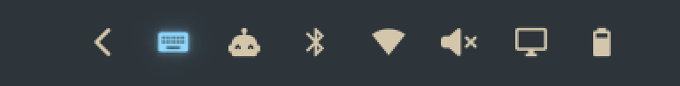

# Omarchy Keylight

A keyboard backlight bar widget for [Omarchy](https://omarchy.org/).

Adds a keyboard-pill to the bar for controlling your laptop keyboard backlight. Left click cycles the brightness up (0 → 1 → max → 0); right click cycles it down; scroll steps it up or down; middle click toggles it off and back on. A push notification (OSD) shows the new brightness level after each step.

Some LED drivers (such as ASUS `asus-nb-wmi`) report brightness as 0 even when lit, so the widget can't always read the real level back from hardware. Instead it keeps its own last-known level in a file under `XDG_STATE_HOME` and refreshes it on every change — the persisted level survives shell reloads and reboots. The true maximum is read from sysfs at load time, so the cycle covers the full range your keyboard supports. Because many laptops boot with the keyboard backlight off, the persisted level is re-applied automatically when the shell loads.

Changes made outside the widget are picked up too: it polls sysfs once a second, using `brightness` on drivers that report it honestly and `brightness_hw_changed` for firmware-handled Fn keys. Every bar (one per monitor) stays in sync through the shared state file.

## Screenshot

The active pill as it appears in the bar, next to the power button:




## Install

Requires an **Omarchy** system (Hyprland + the Omarchy shell), plus:

- **`brightnessctl`** — for setting the LED brightness. Install it with `sudo pamac install brightnessctl` or the equivalent for your package manager.
- A **keyboard backlight** exposed as an LEDs-class device. The first `*kbd_backlight*` device under `/sys/class/leds` is used automatically (`asus::kbd_backlight`, `tpacpi::kbd_backlight`, `dell::kbd_backlight`, …). The pill hides itself when none is found.
- `omarchy-osd` for the brightness notification (ships with Omarchy).

```sh
omarchy plugin add https://github.com/Gnosis80s/OmarchyKeylight.git --enable
```

The command clones the repo, validates it against the Omarchy plugin schema, installs it to `~/.config/omarchy/plugins/gnosis.kbd-backlight/`, and enables it in the bar. The bar hot-reloads; no shell restart is needed.

Not in the position you want? Move it:

```sh
omarchy bar move gnosis.kbd-backlight --section right
```

Or enable it manually if it wasn't added to the bar:

```sh
omarchy plugin enable gnosis.kbd-backlight
```

## Usage

- **Left click** on the pill: increase keyboard backlight one step (wraps from max back to off).
- **Right click**: decrease keyboard backlight one step (wraps from off to max).
- **Scroll**: step up/down, stopping at off and max.
- **Middle click**: toggle off, or back to the last lit level.
- **Hover**: shows the level and percentage.

### IPC

The widget registers the `gnosis.kbd-backlight` IPC target, so keybindings and scripts can drive it and the pill stays in sync:

```sh
omarchy-shell gnosis.kbd-backlight up       # one step brighter
omarchy-shell gnosis.kbd-backlight down     # one step dimmer
omarchy-shell gnosis.kbd-backlight cycle    # same as left click
omarchy-shell gnosis.kbd-backlight toggle   # same as middle click
omarchy-shell gnosis.kbd-backlight set 2    # set an exact level
omarchy-shell gnosis.kbd-backlight get      # print "level/max"
```

On drivers that always read back 0, Omarchy's stock `XF86KbdBrightnessUp/Down` bindings can't tell the current level. Pointing those keys at the IPC calls above fixes that.

## Notes

- To force a specific LED device, add a `device` setting to the widget's entry in `~/.config/omarchy/shell.json`, e.g. `{ "id": "gnosis.kbd-backlight", "device": "asus::kbd_backlight" }` (find names with `brightnessctl -l`).
- Requires `brightnessctl` and a writable `$XDG_STATE_HOME` (defaults to `~/.local/state`); the level is persisted to `~/.local/state/gnosis-kbd-backlight`.
- The pill icon uses a Nerd Font glyph; it renders with the standard Omarchy bar font.

## Layout

```
gnosis.kbd-backlight/
├── manifest.json     # Plugin manifest (id, entry point, bar-widget metadata)
└── BarWidget.qml     # Bar pill: keyboard icon, click/scroll control, sysfs sync, IPC
```
