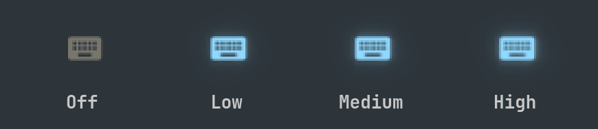

# Omarchy Keylight

**Your keyboard backlight, one click away on the Omarchy bar.**

Typing in a dark room and can't remember which Fn combo lights the keys? Keylight puts a small keyboard icon on your [Omarchy](https://omarchy.org/) bar. Click it to brighten the keys, scroll to fine-tune, or middle-click to turn them off. The icon glows brighter as the backlight does, so you can tell the level at a glance.




## Why Keylight

- **Shows the real level.** The icon is grey when the backlight is off and glows light blue when it's on, brighter with each step. Hover it for the exact level and percentage.
- **Every control on one icon.** Click steps up, right-click steps down, scroll nudges, and middle-click toggles it off and back to where you had it.
- **Keeps your level after a reboot.** Many laptops start with the backlight off. Keylight saves your last level and turns it back on when you log in.
- **Stays correct when you use the Fn keys.** Keylight watches the hardware, so brightness changed from the keyboard shows up on the icon within a second.
- **Fixes keyboards that hide their level.** Some drivers, such as ASUS `asus-nb-wmi`, always report a brightness of 0. Keylight keeps track of the level itself, so the icon, the steps and the restore after a reboot still work.
- **Works on most laptops without setup.** It finds the backlight on its own (ASUS, ThinkPad, Dell and other `*kbd_backlight*` devices) and uses every level your keyboard has. If there's no backlight, the icon hides.
- **Same level on every monitor.** Each monitor's bar shows the same level, whichever one you clicked.
- **Scriptable.** You can set the backlight from a keybinding or script with `omarchy-shell`, and the icon follows.
- **Quick to install.** One command installs it, and the bar reloads by itself.

## Install

```sh
omarchy plugin add https://github.com/Gnosis80s/OmarchyKeylight.git --enable
```

That's all. The command downloads the plugin, checks it against Omarchy's plugin format, installs it to `~/.config/omarchy/plugins/gnosis.kbd-backlight/` and adds it to your bar. The bar reloads without restarting the shell.

To put it somewhere else on the bar:

```sh
omarchy bar move gnosis.kbd-backlight --section right
```

If it isn't on the bar after installing:

```sh
omarchy plugin enable gnosis.kbd-backlight
```

To update to the latest version:

```sh
omarchy plugin update gnosis.kbd-backlight
```

### Requirements

- An **Omarchy** system (Hyprland and the Omarchy shell).
- A laptop with a **keyboard backlight**. Run `brightnessctl -l` and look for a device named `…kbd_backlight`.
- **`brightnessctl`** and **`omarchy-osd`**. Both are already installed on Omarchy; if `brightnessctl` is missing, install it with `sudo pacman -S brightnessctl`.

## Controls

| Action | What it does |
| --- | --- |
| **Left click** | One step brighter (after the brightest level, it goes back to off) |
| **Right click** | One step dimmer (from off, it goes to the brightest level) |
| **Scroll** | Step up or down, stopping at off and at the brightest level |
| **Middle click** | Turn the backlight off, or back to the last level you used |
| **Hover** | Show the current level and percentage |

Each change also shows Omarchy's on-screen brightness indicator.

## Control it from keybindings and scripts

Keylight adds a `gnosis.kbd-backlight` command target to `omarchy-shell`. Whatever changes the brightness, the icon updates to match:

```sh
omarchy-shell gnosis.kbd-backlight up       # one step brighter
omarchy-shell gnosis.kbd-backlight down     # one step dimmer
omarchy-shell gnosis.kbd-backlight cycle    # same as left click
omarchy-shell gnosis.kbd-backlight toggle   # same as middle click
omarchy-shell gnosis.kbd-backlight set 2    # set an exact level
omarchy-shell gnosis.kbd-backlight get      # print "level/max", e.g. 2/3
```

### Fix the brightness keys on laptops that always report 0

Omarchy's built-in keyboard-brightness keys ask the hardware for the current level. On keyboards that always answer 0, the keys never get past the lowest step. To have the keys use Keylight instead, add this to `~/.config/hypr/bindings.lua`:

```lua
hl.unbind("XF86KbdBrightnessUp")
hl.unbind("XF86KbdBrightnessDown")
hl.unbind("XF86KbdLightOnOff")
o.bind("XF86KbdBrightnessUp", "Keyboard brightness up", "omarchy-shell gnosis.kbd-backlight up", { locked = true, repeating = true })
o.bind("XF86KbdBrightnessDown", "Keyboard brightness down", "omarchy-shell gnosis.kbd-backlight down", { locked = true, repeating = true })
o.bind("XF86KbdLightOnOff", "Keyboard backlight toggle", "omarchy-shell gnosis.kbd-backlight toggle", { locked = true })
```

## Configuration

Keylight needs no setup. If your laptop has more than one backlight device, or you want a specific one, add a `device` setting to the widget's entry in `~/.config/omarchy/shell.json`:

```json
{ "id": "gnosis.kbd-backlight", "device": "asus::kbd_backlight" }
```

## How it works

- **Brightness levels.** At startup, Keylight reads how many levels the keyboard has from `/sys/class/leds/<device>/max_brightness`, and sets the brightness with `brightnessctl`.
- **Saved level.** The level is saved to `~/.local/state/gnosis-kbd-backlight` (or `$XDG_STATE_HOME`). That file lets Keylight restore the level after a reboot, keeps every monitor's bar in sync, and records the level on keyboards that always report 0.
- **Changes made elsewhere.** Once a second, Keylight re-reads two hardware values. One is `brightness`, which it trusts once it has ever read something other than 0. The other is `brightness_hw_changed`, which the firmware updates when you use the Fn keys, even on drivers whose `brightness` always reads 0.

## Files

```
gnosis.kbd-backlight/
├── manifest.json     # Plugin manifest (id, entry point, bar-widget metadata)
├── BarWidget.qml     # The bar icon: click/scroll controls, hardware sync, omarchy-shell commands
└── assets/           # README screenshots
```
